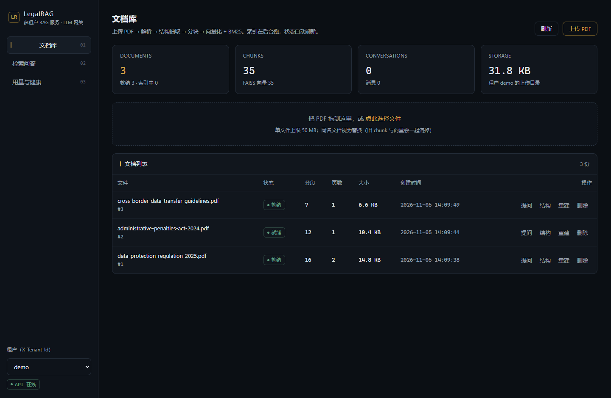
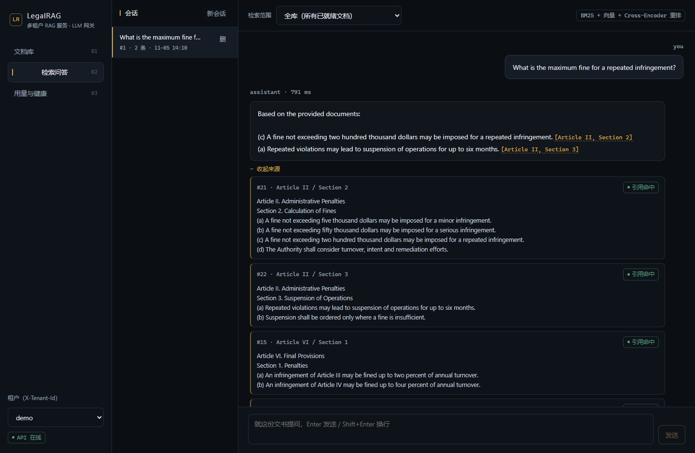
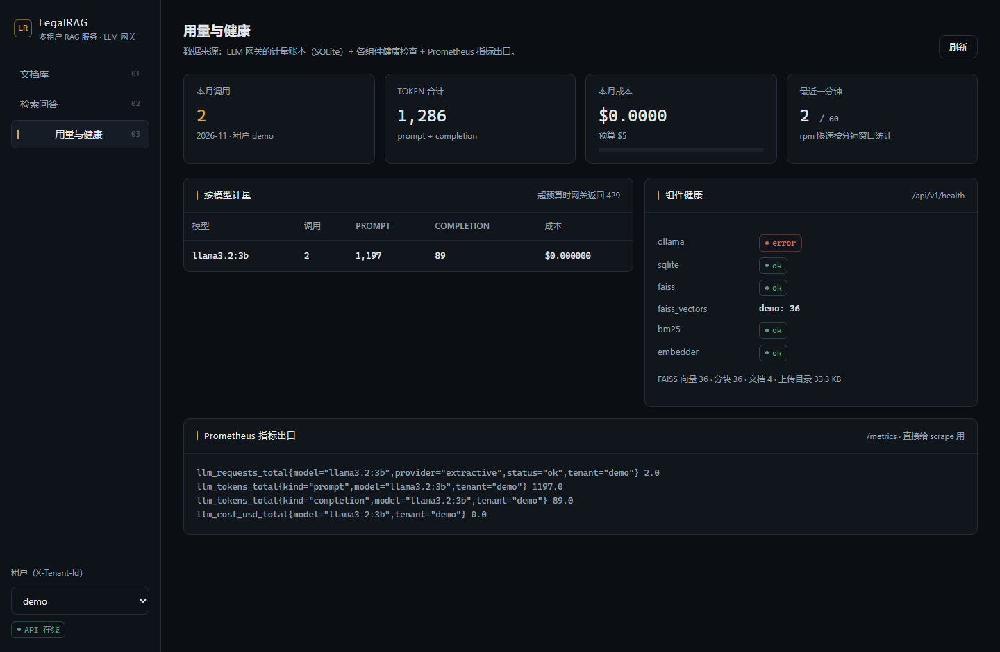

# LegalRAG — 多租户 RAG 服务 + LLM 网关

面向英文法律文书的检索增强生成服务：上传 PDF → 解析/结构化切分 → 混合检索（BM25 + 向量 + Cross-Encoder 重排）→ 带行内引用的问答，答案里的 `[Article X, Section Y]` 可以点开看到召回片段。
外面再套一层 **多租户 LLM 网关**（模型路由、主备降级、配额、token 计量与成本归因）和一个 **React 单页前端**（文档库 / 问答 / 会话历史 / 用量仪表盘）。





## 功能一览

**前端（`web/`，React 18 + TypeScript + Vite）**

- 文档库：拖拽上传、索引进度轮询、分段结构预览（按 Article 分组）、重跑索引、删除
- 问答：流式输出、引用高亮（失效引用画红删除线）、召回来源可展开、检索范围可选单文档或全库
- 会话：历史会话列表、点开即恢复（消息 + 来源 + 引用全部来自数据库）、删除会话
- 用量：本月调用 / token / 成本 / rpm、按模型计量表、组件健康、Prometheus 指标出口
- 租户切换：一个下拉框换数据视角，租户 id 走 `X-Tenant-Id` 头

**后端（`backend/`，FastAPI）**

- 入库流水线：PDF → 结构抽取 → 按条/小节分块 → BGE 向量化 → FAISS + BM25
- 混合检索 + Cross-Encoder 重排，召回与查询共用同一个分词器
- 引用抽取与校验：模型给出的每个条文号都要在召回片段里找得到
- LLM 网关：多 provider、主备降级、租户白名单、月预算、rpm 限速、429/403/401/503 语义
- 四类生成后端：`ollama`（本地模型）/ `openai`（兼容接口）/ `extractive`（无模型基线）/ `fake`（测试）
- 可观测：Prometheus 指标（`/metrics`）、OpenTelemetry span（`docs/trace_demo.py`）
- 三个 SQLite：`data/metadata.db`（文档与分段，随仓库的样本）、`data/usage.db`（计量账本）、`data/conversations.db`（会话与消息）

## 快速开始

### 方式 A：Docker Compose

```bash
# 开箱即用：抽取式基线（不生成，只从召回片段里抽句子并带引用）
docker compose up -d --build          # 打开 http://localhost:8000

# 带本地模型
docker compose --profile llm build
docker compose --profile llm up -d
docker compose exec ollama ollama pull llama3.2:3b
```

### 方式 B：没有 GPU / 不想拉 1.3GB 模型（本机跑）

用**抽取式基线**：不做生成，只从已召回的条文里挑句子并附引用。
检索、重排、引用校验、计量、流式出口全部真实执行 —— 它是链路完整性的对照组，不是 LLM，答不了需要推理的问题。

### 方式 C：本机开发（前后端分开跑）

```bash
# 1. 后端依赖（Python 3.11+）
pip install -r requirements.txt

# 2. 起后端：exporter 用 memory，模型走本地缓存时加 HF_HUB_OFFLINE=1 避免联网校验
LLM_PROVIDER=extractive uvicorn backend.main:app --reload --port 8000

# 3. 起前端（vite dev server，/api 已代理到 8000）
cd web && npm install && npm run dev     # http://localhost:5173
```

生产形态不需要 node：`cd web && npm run build` 产出 `web/dist`，FastAPI 检测到该目录就直接同源托管（前端是客户端路由，服务端做了 index.html 回退）。

### 灌一份演示语料

```bash
python scripts/seed_demo.py --tenant demo    # 三份英文法规，索引完成后打印 chunk 数
```

## 数据与存储

| 文件 | 内容 | 是否入库（git） |
|------|------|-----------------|
| `data/metadata.db` | documents / chunks / definitions，按 tenant 隔离 | 是（样本数据） |
| `data/usage.db` | 网关计量账本：每次调用的 token、成本、延迟 | 否 |
| `data/conversations.db` | conversations / messages（含 sources、citations） | 否 |
| `data/index/<tenant>/vector.faiss` + `.ids.npy` | FAISS 索引与「位置 → chunk 主键」映射 | 是（根目录旧索引）/ 否（按租户） |

映射文件必须和索引一起落盘：FAISS 内部只有 0..N-1 的位置，SQLite 主键从 1 开始，两者不是同一个 id 空间；启动时 `main.py` 会拿映射和数据库 id 集合比对，不一致就按库重建。

## API 一览

| 方法 | 路径 | 说明 |
|------|------|------|
| GET | `/api/v1/health` | 组件健康：ollama / sqlite / faiss / bm25 / embedder |
| GET | `/api/v1/stats` | 文档、分块、向量、会话、消息、存储占用 |
| POST | `/api/v1/documents/upload` | 上传 PDF（≤50MB），后台索引 |
| GET | `/api/v1/documents/` | 文档列表（带状态与 chunk 数） |
| GET | `/api/v1/documents/{id}/status` | 索引状态，前端轮询用 |
| GET | `/api/v1/documents/{id}/chunks` | 分段结构预览 |
| POST | `/api/v1/documents/{id}/reindex` | 重跑解析与索引 |
| DELETE | `/api/v1/documents/{id}` | 删文档：库记录 + 磁盘文件 + 索引重建 |
| POST | `/api/v1/search/` | 混合检索 + 重排，返回分数与条文元数据 |
| POST | `/api/v1/chat/` | 流式问答；带 `conversation_id` 时落库 |
| GET | `/api/v1/chat/sources` | 最近一轮的召回来源与引用校验结果 |
| POST/GET/PATCH/DELETE | `/api/v1/conversations[...]` | 会话增删查改 |
| POST | `/api/v1/gateway/chat` | 走网关的对话（配额 / 计量 / 降级） |
| GET | `/api/v1/gateway/usage` | 本月按模型的调用、token、成本、rpm |
| GET | `/metrics` | Prometheus 出口（不带 `/api/v1` 前缀） |

除 `/health`、`/metrics`、`/api/v1/stats` 外的业务接口都认 `X-Tenant-Id`（未注册租户直接 401）。

## 自检与 CI

```bash
python -m pytest tests -q        # 228 个单测与契约测试
python docs/e2e_check.py         # 端到端 22 项断言：上传→索引→检索→问答→指标→重启一致→同名覆盖
python scripts/ui_smoke.py       # 真浏览器（系统 Edge）走前后端：上传→索引→问答→来源→用量
python docs/trace_demo.py        # 打印一次问答的 span 树
python docs/loadtest.py          # 并发压测，出「并发 vs P99」表
```

GitHub Actions 四个 job：Python 单测 + 端到端 + pgvector 契约、`mcp-server` 编译、`web` 类型检查与打包。

## 已知限制（写清楚比藏着强）

- **没有登录**：租户靠 `X-Tenant-Id` 头，适合内网/演示；对外要做认证、会话与租户绑定
- **单机 SQLite**：并发写靠 `busy_timeout` 顶，多副本部署要换 Postgres
- **pgvector 目前只作契约测试后端**，运行时向量库仍是 FAISS（进程内单例）
- **`extractive` 不是模型**：只做英文词面匹配与抽取，中文问题会被明确拒绝
- **只处理文本型 PDF**，不做 OCR；切分规则针对 `Article N / Section N` 结构，中文法条（第 N 条）切不出层级，引用链会断
- 上传去重按「同租户同名 = 替换」，不做内容哈希去重

## 项目结构

```
legalrag/
├── web/                          # 前端（React 18 + TS + Vite）
│   ├── src/
│   │   ├── api.ts                # 唯一 HTTP 出口：租户头、统一错误、流式读
│   │   ├── types.ts              # 与后端 dict 一一对应的类型
│   │   ├── App.tsx               # 侧栏 / 租户切换 / 路由
│   │   ├── pages/Documents.tsx   # 上传、状态轮询、结构预览、删除
│   │   ├── pages/Chat.tsx        # 会话、流式问答、引用与来源
│   │   ├── pages/Usage.tsx       # 计量、健康、Prometheus
│   │   └── components/Answer.tsx # 引用高亮（含失效引用）
│   └── vite.config.ts            # dev 代理 /api → 8000
├── backend/
│   ├── main.py                   # 应用装配：单例、按租户加载索引、静态托管
│   ├── api/                      # documents / search / chat / conversations / gateway / stats / deps
│   ├── pipeline/                 # parser → structure_extractor → legal_chunker → indexer
│   ├── embedding/embedder.py     # BGE-large-en-v1.5
│   ├── retrieval/                # bm25 / vector_search / hybrid_search / reranker / stores
│   ├── generation/               # pipeline / prompt_builder / citation_builder / providers/*
│   ├── gateway/                  # 路由降级 / 配额 / 单价 / 计量
│   ├── storage/                  # metadata_store（文档与分段）、conversation_store（会话）
│   ├── observability/            # Prometheus 指标 + OTel span
│   └── evaluation/               # 打分与跑批
├── configs/                      # tenants.yaml / prompts.yaml / model_prices.yaml
├── scripts/                      # seed_demo.py（造语料并上传）、ui_smoke.py（真浏览器冒烟）
├── docs/                         # e2e_check.py、trace_demo.py、loadtest.*、screenshots/、source-reading-order.md
├── tests/                        # 228 项单测与契约测试
├── mcp-server/                   # TypeScript MCP server（把检索与问答暴露成 Agent 工具）
├── Dockerfile                    # 四阶段：base → web → backend → app
├── docker-compose.yml            # ollama（profile: llm）+ backend(app)
└── .github/workflows/ci.yml      # Python 测试 / mcp / web
```

## 源码阅读顺序

完整版（含每站要回答的问题）见 [`docs/source-reading-order.md`](docs/source-reading-order.md)，浓缩版：

1. `backend/models/*` —— 三个契约：Document / Chunk / Citation
2. `backend/main.py` —— 装配与启动自检（索引加载、映射校验、租户恢复）
3. `backend/api/deps.py` → `documents.py` → `chat.py` → `conversations.py` —— 四个入口
4. `pipeline/parser.py` → `structure_extractor.py` → `legal_chunker.py` → `indexer.py` —— 一份 PDF 怎么变成 chunk
5. `storage/metadata_store.py` 与 `conversation_store.py` —— 两张库的真相
6. `retrieval/bm25.py` → `vector_search.py` → `hybrid_search.py` → `reranker.py`
7. `generation/pipeline.py` → `prompt_builder.py` → `citation_builder.py` → `providers/*`
8. `gateway/*` —— 多租户、配额、计量、降级
9. `observability/*`、`tests/*`（当规格读）、`docs/e2e_check.py`
10. `web/src/api.ts` → `App.tsx` → `pages/*` —— 前端只做三件事：拿数据、画引用、别丢状态

## 技术栈

| 层次 | 技术 | 用途 |
|------|------|------|
| 前端 | React 18 + TypeScript + Vite | 文档库 / 问答 / 用量，零 UI 框架手写样式 |
| 后端 API | FastAPI + Uvicorn | 异步 REST + 流式响应 |
| PDF 解析 | PyMuPDF + pdfplumber | 文本抽取（含兜底） |
| 向量化 | BGE-large-en-v1.5 | 1024 维英文法律文本向量 |
| 向量库 | FAISS（IndexFlatIP） | 精确内积检索，L2 归一化后等于余弦 |
| 关键词 | rank_bm25 | BM25 召回 |
| 重排 | Cross-Encoder (ms-marco-MiniLM-L-6-v2) | 召回 10 → 重排留 5 |
| 生成 | Ollama / OpenAI 兼容 / 抽取式 | 可切换后端，带主备降级 |
| 存储 | SQLite（三库）+ FAISS 索引 | 元数据、计量、会话 |
| 部署 | Docker 多阶段 + Compose | 单容器同源部署 |
| 观测 | Prometheus + OpenTelemetry | 指标与链路 |

## 许可证

MIT
